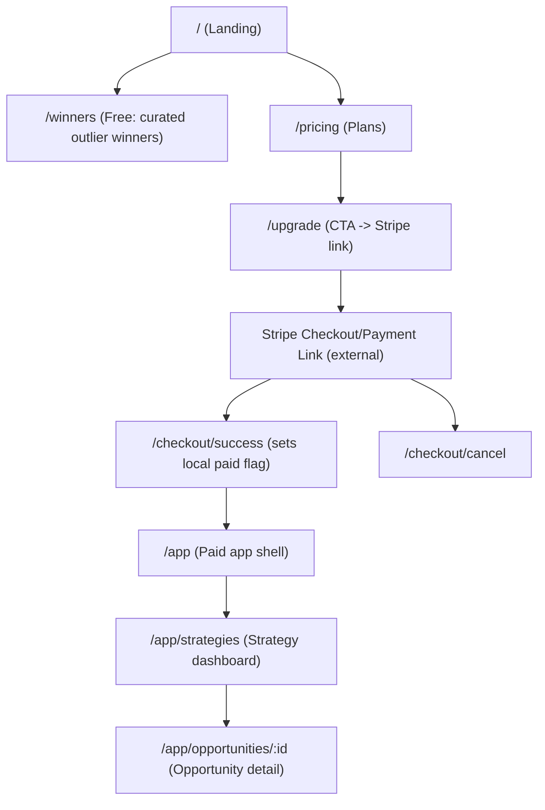

# Front-End Rome Actions to Deliver the MCASui Subscription Experience

## Executive summary

The `dbk000/mcas` repo already contains a production-grade React 18 + Vite + Tailwind SPA (`/Frontend`) with React Router routing, a reusable UI kit (`/Frontend/src/components/ui.jsx`), and Playwright end-to-end tests (`/Frontend/tests/full-ui.spec.js`). fileciteturn10file0L1-L1 fileciteturn11file0L1-L1 fileciteturn45file0L1-L1 fileciteturn39file0L1-L1

To implement the requested MCASui.com feature set **front-end only**, the key architectural move is to split the app into **public (marketing + free tier)** routes and **paid (app)** routes, while preserving the existing “API base URL + API key” connectivity model in `ApiContext` for the paid app (since backend changes are out of scope). fileciteturn17file0L1-L1 fileciteturn31file0L1-L1

Two notable accelerators are already in place:
- The Opportunity detail view already renders a “causality” UI when `sim_trace.kline_lineage` is present via `TraceViewer` (including a causality banner and per-phase causal status). The “Glass Box causality badge” requirement can be satisfied by surfacing a compact badge in the Opportunity header that keys off the same lineage fields. fileciteturn44file0L1-L1 fileciteturn43file0L1-L1
- Profit Factor (PF) is already displayed on run/simulation summary UIs (e.g., `RunDetail` and `SimulationResults`). The “honest PF” requirement can be satisfied by adding **average daily PF** (computed client-side from the fetched trades/results) alongside existing aggregate PF, clearly labeled and explained. fileciteturn23file0L1-L1 fileciteturn22file0L1-L1

Constraint note: I was unable to retrieve any browsable content from **mcasui.com** using the available web-browsing tooling in this session (no indexed results returned), so the plan below treats the user-provided feature description as the source of truth and maps it into the existing `/Frontend` codebase. (No backend changes are assumed or proposed.)

## Current front-end baseline in `dbk000/mcas`

The front-end lives in `/Frontend` and is a Vite SPA with Tailwind and React Router. The repository’s own `Frontend/README.md` documents the page structure (Dashboard, Opportunities, Markets, Runs, Control Plane, Paper Trading, Settings) and the current “terminal aesthetic” UI approach. fileciteturn10file0L1-L1

Routing is centralized in `Frontend/src/App.jsx` and currently treats `/` as the authenticated dashboard behind `ProtectedRoute`. fileciteturn17file0L1-L1

Data fetching is handled through `ApiContext` and `useFetch`/`usePolling` hooks; key endpoints relevant to your requested features include:
- Strategy registry: `GET /v1/strategies` (`useStrategies`) fileciteturn24file0L1-L1
- Opportunities listing: `GET /v1/opportunities` with polling (`useOpportunities`) fileciteturn24file0L1-L1
- Opportunity detail: `GET /v1/opportunities/:id` and `GET /v1/opportunities/live/:setup/:symbol/:tf` (`useOpportunity`, `useLiveOpportunity`) fileciteturn24file0L1-L1

Opportunity detail (`Frontend/src/pages/OpportunityDetail.jsx`) already includes:
- A “Computation Trace” panel with `TraceViewer` for `opp.trace` / `opp.sim_trace`. fileciteturn43file0L1-L1
- A “Timestamps” section including `candle_ts` / `bar_start_ts` if present. fileciteturn43file0L1-L1
- The “Glass Box” causality UI is effectively present inside `TraceViewer` when `simTrace.kline_lineage` exists (banner + per-phase causality). fileciteturn44file0L1-L1

Testing exists as a Playwright suite in `/Frontend/tests/full-ui.spec.js` with a config in `/Frontend/playwright.config.js`. The existing tests assume `/` is the authenticated dashboard and inject API config into localStorage. Any reroute to place a marketing landing page at `/` must update these tests accordingly. fileciteturn38file0L1-L1 fileciteturn39file0L1-L1

## Feature-to-Rome-action implementation map

The Rome actions below are the *minimal front-end tasks* to deliver the requested experience, mapped to concrete files/paths in the repo and to the UI behaviors/tests you should add or update.

| Feature | Rome action | Repo file(s) to change | UI behavior/tests |
|---|---|---|---|
| Landing page with value proposition | **ROME-FE-001: Introduce public marketing routes + layout** | `Frontend/src/App.jsx` (route split), new `Frontend/src/pages/Landing.jsx`, new `Frontend/src/components/MarketingLayout.jsx` | `/` renders landing. Playwright: update “Settings loads” test to visit `/settings`; add “Landing loads” assertion. fileciteturn17file0L1-L1 fileciteturn39file0L1-L1 |
| Free tier: curated outlier winners (10–20 per strategy) | **ROME-FE-002: Add Winners gallery backed by static JSON** | new `Frontend/public/curation/winners.v1.json`, new `Frontend/src/pages/Winners.jsx`, optional `Frontend/src/components/winners/*` | `/winners` shows per-strategy sections (10–20 entries). CTA to upgrade. Playwright: add a test that `/winners` renders strategy sections and at least N cards. |
| Paid tier gate (€50/mo) | **ROME-FE-003: Subscription context + paid route guard** | new `Frontend/src/context/SubscriptionContext.jsx`, update `Frontend/src/main.jsx` to wrap provider, new `Frontend/src/components/PaidRoute.jsx` | Paid-only routes show paywall screen if not “paid”. Playwright: ensure unpaid user can hit `/` + `/winners`, but is blocked from `/app/*`. fileciteturn40file0L1-L1 |
| Stripe (or equivalent) front-end flow | **ROME-FE-004: Upgrade page + redirect/return pages** | new `Frontend/src/pages/Pricing.jsx`, `Frontend/src/pages/Upgrade.jsx`, `Frontend/src/pages/CheckoutSuccess.jsx`, `Frontend/src/pages/CheckoutCancel.jsx`, `Frontend/src/App.jsx` routes | Upgrade CTA routes to Stripe link. On success return, set local “paid” flag and route user to `/app`. Playwright: simulate setting paid flag in localStorage and verify `/app` accessible. |
| Strategy dashboard: live opportunities per strategy | **ROME-FE-005: StrategyDashboard page grouping `useOpportunities()` by `setup_id`** | new `Frontend/src/pages/StrategyDashboard.jsx`, update `Frontend/src/App.jsx`, update navigation in `Frontend/src/components/Layout.jsx` | `/app/strategies` shows list of strategy cards with live counts and top opportunities per strategy, updating on poll interval. fileciteturn24file0L1-L1 fileciteturn36file0L1-L1 |
| Opportunity detail: Glass Box causality badge | **ROME-FE-006: Header-level causality badge** | `Frontend/src/pages/OpportunityDetail.jsx` (header), optional small helper component `Frontend/src/components/opportunities/CausalityBadge.jsx` | Opportunity header shows “Glass Box: Verified / Violation / Unavailable” based on `opp.sim_trace?.kline_lineage?.causality_verified`. fileciteturn43file0L1-L1 fileciteturn44file0L1-L1 |
| PF metrics displayed honestly (avg daily, not aggregate) | **ROME-FE-007: Add Avg Daily PF alongside aggregate PF** | `Frontend/src/pages/RunDetail.jsx`, `Frontend/src/pages/SimulationResults.jsx`, new helper `Frontend/src/utils/pf.js` | UI displays: Aggregate PF (existing) + Avg Daily PF (new) + tooltip explaining calculation. Tests: unit test for PF calc if you add a small pure function; Playwright: ensure the new label appears on results pages. fileciteturn23file0L1-L1 fileciteturn22file0L1-L1 |
| Mobile-responsive design | **ROME-FE-008: Mobile nav + responsive layout** | `Frontend/src/components/Layout.jsx`, `Frontend/src/index.css` (minor), optionally new `Frontend/src/components/MobileNav.jsx` | Sidebar becomes drawer on small screens; main content spacing adapts. Playwright: add mobile viewport test for landing + winners + strategy dashboard. fileciteturn36file0L1-L1 fileciteturn41file0L1-L1 |
| Keep automated coverage after route split | **ROME-FE-009: Update Playwright suite for new route map + paywall** | `Frontend/tests/full-ui.spec.js`, optionally `Frontend/package.json` add `test:e2e` script | Tests no longer assume `/` is dashboard; add helpers for “set paid flag” and “set API config” separately. fileciteturn39file0L1-L1 fileciteturn11file0L1-L1 |

### Proposed route structure after implementation

This route map keeps the existing “app” features intact while enabling marketing + subscription gating.



## Codex prompts per Rome action

Each prompt below is designed to be pasted into Codex as a self-contained instruction set. They assume **front-end only**, and they follow the current repo’s conventions (React Router, Tailwind utility classes, `ui.jsx` components, Playwright tests). fileciteturn17file0L1-L1 fileciteturn45file0L1-L1 fileciteturn39file0L1-L1

### ROME-FE-001 prompt

```text
You are editing repo dbk000/mcas, FRONTEND ONLY under /Frontend.

Goal: Make "/" a public landing page (marketing), and move the existing authenticated app to "/app/*".

Constraints:
- Do NOT change backend.
- Preserve existing pages and behaviors under the new /app prefix.
- Keep Tailwind styling consistent with existing UI.
- Ensure accessibility: semantic headings, focus-visible styles already exist; ensure buttons/links have discernible text; ensure mobile tap targets.

Edits:
1) Update Frontend/src/App.jsx:
   - Add new routes:
     - "/" -> <Landing />
     - "/pricing" -> <Pricing /> (stub ok if not yet built)
     - "/winners" -> <Winners /> (stub ok if not yet built)
     - "/upgrade" -> <Upgrade /> (stub ok)
     - "/checkout/success" -> <CheckoutSuccess /> (stub ok)
     - "/checkout/cancel" -> <CheckoutCancel /> (stub ok)
   - Wrap existing Layout + ProtectedRoute routes under "/app":
     - "/app" -> Dashboard
     - "/app/opportunities" -> Opportunities
     - "/app/opportunities/:id" -> OpportunityDetail
     - "/app/markets" etc (all existing routes should become "/app/..." equivalents)
   - Update the catch-all:
     - Unknown paths should go to "/" (landing), NOT "/app".
2) Add new file Frontend/src/pages/Landing.jsx:
   - Layout: hero section with value proposition, 3 feature bullets, clear CTA buttons:
     - Primary CTA: "See live opportunities" -> link to "/upgrade"
     - Secondary CTA: "See free outlier winners" -> link to "/winners"
   - Add a "Glass Box" / "Causality" credibility strip and "Honest metrics" strip (marketing copy only).
   - Add risk disclaimer at bottom (not financial advice).
   - Responsive: stack sections on mobile; max width on desktop; use existing terminal theme colors.
3) Add new file Frontend/src/components/MarketingLayout.jsx (optional but recommended):
   - Simple top nav with links: Home, Winners, Pricing, Upgrade
   - Mobile: hamburger menu or stacked nav (simple version acceptable)
   - Use <main> with padding and max width.

Implementation details:
- Use existing button classes: "btn btn-primary", "btn btn-secondary", "btn btn-ghost" from index.css.
- Use existing Card/Badge components if helpful.

Tests:
- Update Frontend/tests/full-ui.spec.js:
  - Any test that assumes "/" is dashboard must be updated:
    - "Dashboard loads" should go to "/app" after setting auth
    - Redirect tests should target "/app" routes, not "/"
  - Add a new test: Landing page loads and contains "See free outlier winners" link.
- Ensure Playwright still runs with baseURL http://localhost:3000.

Deliverables:
- App.jsx updated routes
- Landing.jsx created
- MarketingLayout.jsx created (if used)
- Playwright tests updated accordingly
```

### ROME-FE-002 prompt

```text
Repo: dbk000/mcas. Frontend only.

Goal: Implement the FREE tier "curated outlier winners" page.
- Show 10–20 winners per strategy.
- Make reverse-engineering difficult by design (front-end only):
  - Do NOT show exact entry/stop/TP levels
  - Do NOT show exact candle timestamps; show approximate date (YYYY-MM-DD) and timeframe only
  - Do show outcome magnitude and a short narrative "why it mattered" (static copy)
  - Label clearly that these are "curated historical examples"

Edits:
1) Create Frontend/public/curation/winners.v1.json with schema:
   {
     "version": "v1",
     "generated_at": "YYYY-MM-DD",
     "strategies": [
       {
         "setup_id": "S9",
         "label": "S9 Dormancy Breakout",
         "items": [
           {
             "id": "S9_001",
             "symbol": "BTCUSDT",
             "timeframe": "1h",
             "direction": "long",
             "date": "2026-02-12",
             "outcome_pct": 18.4,
             "holding_bars": 9,
             "notes": ["Dormancy resolved", "Volume spike confirmed"],
             "cta_tease": "See the live signal timing + Glass Box causality in Pro"
           }
         ]
       }
     ]
   }
   Populate with placeholder data if real curation not provided yet, but keep 2–3 items per strategy for now and clearly mark as placeholder.

2) Create Frontend/src/pages/Winners.jsx:
   - Fetch the JSON from "/curation/winners.v1.json"
   - Render a strategy section per entry:
     - Strategy header, short description
     - Grid of winner cards (use Card component).
     - Each card: symbol, tf, direction, date, outcome %, short notes
     - CTA button on each card: "Unlock live version" -> "/upgrade"
   - Add a banner at top: "Free tier: curated outlier winners" + "Not enough detail to copy; enough to validate edge"
   - Responsive: 1 column on mobile, 2 on md, 3 on lg.

3) Add lightweight error handling:
   - If JSON fails to load, show EmptyState with retry.

Tests:
- Add Playwright test:
  - page.goto("/winners") should render heading and at least one strategy section.
  - In mobile viewport, ensure page renders without overflow (screenshot ok).
```

### ROME-FE-003 prompt

```text
Repo: dbk000/mcas. Frontend only.

Goal: Add subscription gating (free vs paid) WITHOUT backend changes.
Important limitation: this is only a UX gate; do NOT claim it is secure.

Edits:
1) Add new context: Frontend/src/context/SubscriptionContext.jsx
   - Store "tier" in localStorage, key = "mcas_tier", values: "free" | "paid"
   - Expose:
     - tier
     - isPaid = tier === "paid"
     - setPaid(), setFree(), clearTier()
   - Also store an optional "activated_at" timestamp for UX.

2) Update Frontend/src/main.jsx to wrap <App /> with <SubscriptionProvider>.
   Keep existing providers: ToastProvider, ApiProvider, BrowserRouter. Follow current nesting style.

3) Add new component Frontend/src/components/PaidRoute.jsx
   - Similar to ProtectedRoute, but checks subscription status from SubscriptionContext.
   - If not paid:
     - Render a Paywall screen (simple full-page) with:
       - Title: "Unlock Pro"
       - Bullet list of paid benefits: live opportunities per strategy, Glass Box causality, honest PF breakdown
       - Buttons: "Upgrade — €50/month" -> "/upgrade"; "See free winners" -> "/winners"
   - Accessibility: ensure focusable elements, sensible heading order.

4) Update Frontend/src/App.jsx:
   - Wrap "/app/*" routes in <PaidRoute> (AND inside that keep existing <ProtectedRoute> for API config if needed).
   - Decision: paid gate should happen BEFORE API-config gate so paid users don’t see settings unless needed.

Tests:
- Update Playwright:
  - Add helper to set localStorage mcas_tier="paid" before visiting "/app".
  - Ensure unauth/ unpaid user visiting "/app" is redirected/shown paywall.
  - Ensure "/winners" remains accessible without paid tier.
```

### ROME-FE-004 prompt

```text
Repo: dbk000/mcas. Frontend only.

Goal: Implement Stripe (or equivalent) front-end flow as a redirect.
No backend changes allowed, so do NOT implement server-created Checkout Sessions.
Instead:
- Support redirecting to a configurable external payment URL (Payment Link or hosted checkout).
- Implement success/cancel return pages.

Edits:
1) Add env-configurable payment URL:
   - In Vite: use import.meta.env.VITE_STRIPE_PAYMENT_URL
   - If not set, disable upgrade button and show "Contact support" fallback.

2) Create Frontend/src/pages/Pricing.jsx:
   - Show two cards:
     - Free: Winners gallery + limited previews
     - Pro: €50/month, includes Strategy Dashboard, Glass Box causality, honest PF metrics
   - CTA "Upgrade" links to "/upgrade"

3) Create Frontend/src/pages/Upgrade.jsx:
   - Explain what happens:
     - You’ll be redirected to checkout
     - After checkout, you’ll return here and Pro will be activated on this device
   - Button: "Continue to checkout" -> window.location.href = payment URL
   - Secondary: "Back to pricing"

4) Create Frontend/src/pages/CheckoutSuccess.jsx:
   - On mount:
     - call setPaid() from SubscriptionContext
     - show confirmation message
     - button: "Go to app" -> "/app"
   - If you want, read query params like session_id for display only, but do NOT treat it as verification.

5) Create Frontend/src/pages/CheckoutCancel.jsx:
   - Show canceled message, link back to "/pricing" and "/winners".

6) Wire routes in App.jsx.

Tests:
- Playwright:
  - Since real Stripe redirect cannot happen in CI, test local behavior:
    - page.goto("/checkout/success") sets mcas_tier to "paid" and shows "Go to app"
    - page.goto("/checkout/cancel") shows cancellation UI
```

### ROME-FE-005 prompt

```text
Repo: dbk000/mcas. Frontend only.

Goal: Implement "/app/strategies" Strategy Dashboard:
- Show live opportunities per strategy using existing endpoints/hooks:
  - useStrategies() for registry
  - useOpportunities({ status:"active", limit:<reasonable> }) for opportunity feed
- Group opportunities by setup_id and display counts + top N per strategy.
- Must update live via existing polling behavior.

Edits:
1) Create Frontend/src/pages/StrategyDashboard.jsx
   - Fetch strategies via useStrategies()
   - Fetch opportunities via useOpportunities({ status:"active", min_score:0, limit:200 })
   - Compute:
     - perStrategy = map setup_id -> list of opps
     - For each strategy card:
       - label, status (if present), opportunity count
       - show top 3–5 opportunities with symbol, tf, direction, score
       - "View all" link -> "/app/opportunities?setup_id=S9" (if query params supported) OR link -> "/app/opportunities" and prefill via URL param read
   - Provide skeleton/EmptyState like existing patterns.

2) Update navigation in Frontend/src/components/Layout.jsx:
   - Add "Strategies" item pointing to "/app/strategies"
   - Update existing hrefs to be prefixed with "/app" across the nav list.
   - Keep Settings at "/settings" (public).

3) Update App.jsx to add route "/app/strategies" (paid+protected).

Tests:
- Playwright:
  - After setting paid + API config, page.goto("/app/strategies") renders "Strategies" and at least one strategy card (or EmptyState if API returns none).
  - Add mobile viewport screenshot test for "/app/strategies".
```

### ROME-FE-006 prompt

```text
Repo: dbk000/mcas. Frontend only.

Goal: Add a compact "Glass Box" causality badge to the Opportunity detail header.
Do NOT reinvent causality logic; reuse existing data already displayed by TraceViewer:
- sim_trace.kline_lineage.causality_verified (true/false/null)

Edits:
1) Update Frontend/src/pages/OpportunityDetail.jsx:
   - In the header next to setup_id badge, add:
     - If opp.sim_trace?.kline_lineage exists:
       - If causality_verified === true: Badge variant="success" text "Glass Box: Verified"
       - If causality_verified === false: Badge variant="error" text "Glass Box: Violation"
       - Else: Badge variant="default" text "Glass Box: Unknown"
     - If no lineage: Badge variant="default" text "Glass Box: N/A"
   - Tooltip (title attribute) explaining:
     - Verified means decision timestamp and bar timing constraints passed; violation means mismatch; N/A means no lineage attached.

2) Optional: create small component Frontend/src/components/opportunities/GlassBoxBadge.jsx to keep OpportunityDetail clean.

Tests:
- Unit-ish: add a small render test? (optional in this repo)
- Playwright: not reliable without data, but you can test that the label renders when you mock local opportunity object in a lightweight component story. If skipping, at least ensure no crash.
```

### ROME-FE-007 prompt

```text
Repo: dbk000/mcas. Frontend only.

Goal: Display Profit Factor honestly as "Avg Daily PF" (average daily profit factor) alongside Aggregate PF.
- Do NOT remove existing PF; add clarity.
- Compute Avg Daily PF client-side from trades/results already available.
- Clearly label methodology in UI tooltip (title) and a short footnote.

Implementation:
1) Create Frontend/src/utils/pf.js with PURE functions:
   - groupPnLByDay(items, tsField, pnlField):
       returns map YYYY-MM-DD -> { grossProfit, grossLossAbs }
   - profitFactor(grossProfit, grossLossAbs):
       if grossLossAbs==0:
         - if grossProfit>0 return Infinity indicator (display "∞")
         - else return null
       else return grossProfit / grossLossAbs
   - averageDailyPF(items, tsField, pnlField):
       compute PF per day (ignoring days with 0 trades), then arithmetic mean.

2) Update Frontend/src/pages/RunDetail.jsx:
   - In OverviewTab (where Profit Factor is displayed), add a new StatCard:
       label: "Avg Daily PF"
       value: computed from trades list (you already fetch trades in TradesTab; for Overview you may need to fetch trades as well, or add a lightweight endpoint call using useRunTrades in OverviewTab).
   - Add tooltip describing:
       "Avg Daily PF = mean over days of (gross profit / gross loss) computed per day from realized trade PnL."

3) Update Frontend/src/pages/SimulationResults.jsx:
   - Add the same "Avg Daily PF" stat (computed from results[] using exit_ts or similar timestamp field; if only created_at exists, use that).
   - Keep existing "Profit Factor" (aggregate) visible.

4) Ensure formatting:
   - Display "∞" if a day has losses=0 and profits>0; for averaging, either cap at a max (e.g., 10) or exclude infinite days; choose one and document it in tooltip.

Tests:
- Add minimal unit tests for pf.js (if you have no test runner, add small node script or keep logic simple).
- Playwright: ensure "Avg Daily PF" label exists on SimulationResults page when data loads.
```

### ROME-FE-008 prompt

```text
Repo: dbk000/mcas. Frontend only.

Goal: Mobile responsiveness across marketing + app:
- Landing, Winners, Pricing must be mobile-first.
- App shell sidebar must not consume the whole screen on mobile.

Edits:
1) Update Frontend/src/components/Layout.jsx:
   - Add a mobile breakpoint behavior:
     - On <md: sidebar hidden by default
     - Add a hamburger button in Header that toggles a drawer sidebar overlay
     - Drawer: fixed inset-y-0 left-0, width ~80vw, backdrop overlay; close on backdrop click or Esc.
   - Keep existing collapse behavior for desktop.

2) Ensure main content padding:
   - For app pages: use smaller padding on mobile (p-3) and p-6 on md+
   - For marketing pages: use max-w-6xl mx-auto with px-4

3) Add skip-link for accessibility (optional):
   - a[href="#main"] at top to skip navigation
   - main id="main"

Tests:
- Extend Playwright mobile viewport suite:
  - Landing renders at 375x812
  - Winners renders at 375x812
  - App strategies renders at 375x812 when paid+auth
```

### ROME-FE-009 prompt

```text
Repo: dbk000/mcas. Frontend only.

Goal: Update Playwright tests to match new routing + subscription gate.

Edits:
1) Frontend/tests/full-ui.spec.js
   - Update setupAuth(page):
       - Visit "/app" instead of "/"
       - Set localStorage:
           - mcas_tier = "paid"
           - mcas_api_config = { baseUrl, apiKey }
   - Update Auth Protection tests:
       - Without config & without tier, visit "/app" and assert paywall visible (or redirect to "/upgrade")
       - Without config but paid tier, visit "/app" and assert redirect to "/settings" still happens (if you keep API-config guard)
   - Update route list arrays to use "/app/..." paths for all app routes.

2) Optional: add package.json scripts:
   - "test:e2e": "playwright test"
   - Keep existing scripts intact.

Acceptance:
- Tests run locally against http://localhost:3000 and no longer assume "/" is the dashboard.
```

## Stripe integration UX notes for a front-end-only gate

Because backend changes are excluded, the “Stripe integration” here can only be implemented as a **client-side purchase UX** and **client-side entitlement state** (e.g., localStorage). That is good enough to ship a conversion funnel and validate pricing, but it is not a secure entitlement system.

A pragmatic front-end-only flow is:
- `Pricing` explains Free vs Pro and the €50/month positioning.
- `Upgrade` does a simple redirect to a configured hosted checkout URL (e.g., Stripe Payment Link).
- `CheckoutSuccess` sets a “paid” flag for the device/session and routes users into `/app`.
- Paid users still likely need a **separate** way to gain API access (since `ApiContext` requires an API key and refuses requests otherwise). fileciteturn31file0L1-L1

For the best UX under these constraints, the Pro onboarding screen should explicitly show:
- Step: “Subscribe”
- Step: “Activate this device”
- Step: “Connect your MCAS endpoint” (baseUrl + API key) with a clear explanation of where the key comes from (manual fulfillment or existing process).

## Mobile responsiveness checklist and suggested CSS/JS changes

The existing UI is desktop-oriented with a persistent sidebar (`w-64`), so prioritize layout containment and navigation on small screens. fileciteturn36file0L1-L1

Mobile-ready checklist:
- Landing/Winners/Pricing: single-column flow; max width; CTAs always visible without horizontal scroll.
- App shell: sidebar becomes a drawer on `<md`; hamburger in header; backdrop dismiss; ESC dismiss; focus trap if you add a modal-like drawer.
- Card grids: ensure `grid-cols-1 md:grid-cols-2 lg:grid-cols-3` patterns; avoid dense 6-column metric grids on mobile (convert to 2 columns or horizontal scroll).
- Tables: wrap in `overflow-x-auto` (already used in some pages like `SimulationResults`). fileciteturn22file0L1-L1
- Tap targets: use at least the repo’s existing button sizing (`btn`, `btn-sm`) and avoid icon-only buttons on mobile without labels/tooltips. fileciteturn41file0L1-L1

Suggested implementation approach:
- Keep most styling in Tailwind classes; only add minimal new CSS to `index.css` if truly necessary (the project already centralizes reusable button/input styling there). fileciteturn41file0L1-L1

## PR checklist and front-end-only testing instructions

### PR checklist

Code and UX
- Routes: `/` is marketing; `/app/*` is the paid app; internal links updated accordingly (`Layout.jsx` nav, deep links in pages). fileciteturn17file0L1-L1 fileciteturn36file0L1-L1
- Subscription gate: unpaid users cannot enter `/app/*` without seeing a clear upgrade path; free pages remain accessible.
- “Glass Box” badge added to Opportunity header and matches `TraceViewer` causality banner semantics. fileciteturn43file0L1-L1 fileciteturn44file0L1-L1
- PF honesty: “Avg Daily PF” is clearly labeled and does not replace aggregate PF; tooltip explains calc.
- Accessibility: headings in order; buttons have text; drawer/menu is keyboard-operable; focus-visible ring still works. fileciteturn41file0L1-L1

Security & privacy (front-end only)
- No secrets embedded: do not hardcode API keys or Stripe secret keys client-side; only allow a public payment URL in `VITE_*` config.
- Do not treat Stripe return params as proof of payment; treat as UX only and note the limitation in copy.
- Avoid logging personally identifiable information (email, payment details) to console or client logs.

### Manual testing

Marketing
- `/` renders quickly, CTAs go to `/winners` and `/upgrade`.
- `/winners` loads JSON, shows per-strategy cards, and doesn’t expose trade-plan-level detail.

Subscription UX
- Unpaid: visit `/app` and confirm paywall screen is shown.
- Paid: set localStorage `mcas_tier=paid` (temporary) and confirm `/app` loads.
- Checkout pages: `/checkout/success` sets paid flag; `/checkout/cancel` does not.

App
- Strategy dashboard: `/app/strategies` shows strategies and live opportunities; verify updates over time (polling). fileciteturn24file0L1-L1
- Opportunity detail: confirm the new Glass Box badge appears when `sim_trace.kline_lineage` exists.
- Runs/Simulation: confirm PF cards show both aggregate PF and Avg Daily PF.

Mobile
- Use device toolbar at ~375px width:
  - Marketing pages: no horizontal scroll; text readable.
  - App: sidebar behaves as drawer; can open/close; main content readable.

### Automated testing (Playwright)

- Update `Frontend/tests/full-ui.spec.js` so it:
  - Stops assuming `/` is dashboard.
  - Uses `/app` for authenticated/paid pages.
  - Sets both: `mcas_tier="paid"` and `mcas_api_config={baseUrl,apiKey}` where tests require backend connectivity. fileciteturn39file0L1-L1
- Keep the existing mobile viewport screenshots and add coverage for `/`, `/winners`, and `/app/strategies`. fileciteturn39file0L1-L1

## Extra front-end additions that help sell subscriptions

These are front-end-only enhancements that typically improve conversion without needing backend work:

A strong “Why trust this?” section on the landing page: you already have the raw ingredients (trace + causality + integrity messaging in `TraceViewer`). Reframe it as a credibility story: “Signals are timestamped; causality is checked; metrics are displayed honestly.” Then link to a screenshot-style “What Glass Box looks like” section (can be a static image asset you add under `Frontend/public/marketing/`). fileciteturn44file0L1-L1

A lightweight “interactive demo” mode: build a `DemoOpportunity` card/page that uses a static JSON fixture to render a realistic opportunity detail (including a fake-but-structurally-correct `sim_trace.kline_lineage` object). This lets prospects experience the Pro UX without backend connectivity, and it’s very effective for selling analytical products.

Pricing page persuasion primitives:
- A simple ROI framing widget (client-only): user chooses trades/week and average edge assumptions; UI displays “break-even” scenarios. Keep disclaimers prominent.
- A comparison table (Free vs Pro) with the one or two “power” features highlighted: Strategy Dashboard + Glass Box + honest PF breakdown.

Reduce friction after purchase:
- Post-checkout success page should do exactly one thing well: “Go to app” + “Connect your endpoint” checklist (baseUrl + key). This aligns with how the current app already works through `ApiContext` configuration and `ProtectedRoute`. fileciteturn31file0L1-L1 fileciteturn17file0L1-L1