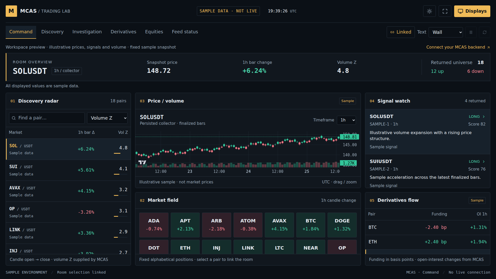

# Trading lab screens

The lab is a standalone, read-only workspace in the existing React frontend. Open one window per monitor or projector, give each a view, and link market/timeframe selection across the room. It reuses MCAS authentication, subscription checks, API settings, governed configuration and persisted collector data.



## Launch

From a checkout containing this change:

```bash
cd Frontend
npm ci
npm run dev -- --host 127.0.0.1
```

- Open `http://127.0.0.1:5173/lab-preview` to arrange screens with the fixed, explicitly labelled sample dataset. This route requires no backend or subscription. It never falls back to live prices.
- For live data, configure the MCAS backend at `/settings`, establish the existing authenticated session and subscription access, then open `/app/lab` or choose **Trading Lab** in the app sidebar. There is no new API key or token in a display URL.
- `npm run build` creates the production frontend. Existing hosting and backend configuration still apply.

The existing global maintenance overlay is intentionally unchanged. It currently bypasses localhost/IP hosts but can cover the application on hosted domains. Enabling a hosted lab requires a separate decision about that existing gate and the normal deployment approval; merging to `main` can trigger Cloudflare Pages deployment.

## Arrange the room

1. Choose **Displays**. Rename the four starting profiles and add more for the rest of the room. Each profile has a view, linked/pinned behavior and optional starting symbol.
2. Select **Save profile**. Profiles and display preferences are stored in this browser.
3. Use each profile's **Open** link, move its window to the intended physical display, and enter fullscreen with the toolbar or the browser's fullscreen shortcut. The app does not need permission to position OS windows.
4. Select a market on Discovery or Command. Other **Linked** lab windows on the same origin and browser profile follow its symbol and timeframe. **Pinned** windows keep their own selection.
5. Use **Desk**, **Wall** or **Large wall** text sizing and the light/dark control for the viewing distance and projector. Desktop wall layouts use the available screen height; long lists scroll inside panels. Narrow screens stack panels vertically.

Display URLs are bookmarkable. For example:

```text
/app/lab?view=discovery&name=Discovery+wall&follow=1&scale=125&theme=dark
/app/lab?view=investigation&name=BTC+desk&follow=0&symbol=BTCUSDT&tf=1h
/app/lab?view=derivatives&name=Flow+wall&follow=1
```

Linking uses `BroadcastChannel` with a storage-event fallback, scoped by backend URL. Sample and live selections are isolated. Cross-device synchronization and automatic OS window placement are not part of this version.

## Views

| View | Content |
| --- | --- |
| Command | Discovery ranking, finalized price/volume chart, signal watch, alphabetical market field and derivatives summary |
| Discovery | Searchable universe ranked by backend Volume Z, absolute candle move or symbol; stable alphabetical market tiles |
| Investigation | Selected market chart, returned active signals, entry/stop/target and backend context |
| Derivatives | Funding in basis points, open-interest changes, taker-buy ratio and source bar age |
| Equities | Backend model opportunities with expected return, probability, confidence, regime and horizon |
| Feed status | Per-feed age/error state, backend connection and explicit missing-feed notes |

The chart supports pan/zoom and the timeframes supplied by governed configuration. Signal evidence opens the existing opportunity page. The lab does not place orders or change strategies, risk parameters or backend settings.

## API contracts and data behavior

| Read endpoint | Lab uses |
| --- | --- |
| `/v1/universe/heatmap?period=1h&tf=…` | `tiles`: symbol, close, pct_change, volume_z, stale, as_of_ts |
| `/v1/ohlcv?symbol=…&tf=…&limit=…` | symbol, timeframe, candles, collector_as_of_ts; only valid `is_final: true` OHLCV bars |
| `/v1/opportunities?status=active&limit=…` | opportunities, setup, direction, score, rationale, source timestamps and optional payload prices |
| `/v1/derivatives/dashboard?limit=…` | symbols, funding_rate, OI percentage changes, taker_buy_ratio, bar_start_ts and data_as_of_ts |
| `/v1/equities/opportunities?status=active&limit=…` | model opportunities and updated_at |

- The heatmap implementation returns selected-bar open-to-close change. The UI labels it with the selected timeframe, never as a rolling 24-hour return. The API's `period` argument does not currently alter that calculation.
- MCAS supplies all indicators, strategy scores and predictions. Frontend calculations only format values, sort/filter records, count returned rows and evaluate age. Missing numeric values render as `—`, not zero.
- Polling intervals, request timeouts, page limits, timeframes and staleness thresholds come from `src/config/governed.js`. Only feeds used by the active view poll; Feed status checks all five.
- Each feed polls serially. Changing endpoint, backend, market or timeframe cancels the old request and immediately hides results from the old key. A failed update retains matching cached records with an error indication.
- **Pause** cancels polling while source ages continue to advance. **Refresh** performs one read per enabled feed, including while paused.
- Freshness is based on source timestamps, not a successful HTTP request or response-envelope timestamp. Individual universe records carry their own age; a panel summary is not proof that every row is current.
- The OHLCV endpoint in this checkout accepts symbol/timeframe but no venue parameter. Chart identity is backend + collector + symbol + timeframe; this UI does not claim interchangeable cross-exchange prices.
- The public sample snapshot is deliberately illustrative. Its compact candle path is expanded only by the preview adapter. The live path never substitutes sample records for missing data.

## Current integration boundary

These screens use the read APIs present in this checkout. There are no lab-ready historical news, social history, order-book or execution APIs in the inspected interface, so those have not been fabricated. The current equities endpoint exposes model opportunities rather than equity OHLCV charts. A later read API can supply additional panels without replacing the room runtime.

Live production connectivity has not been exercised from this development environment. The browser suite checks the live route against API-shaped fixtures, including authentication, source staleness, rejected forming bars, timeframe changes, pause/manual refresh, failed reads and recovery. The public sample preview is useful for layout review, not evidence of live-feed availability.

## Verification

```bash
cd Frontend
npm run test:unit
npx playwright install chromium
npm run test:e2e:lab
```

The lab browser suite runs desktop and mobile projects, linked/pinned windows, saved profiles, all six views and landscape/portrait wall layouts. `PLAYWRIGHT_CHROMIUM_EXECUTABLE` can point at an already installed Chromium when browser downloads are unavailable. No new application dependencies were added.
