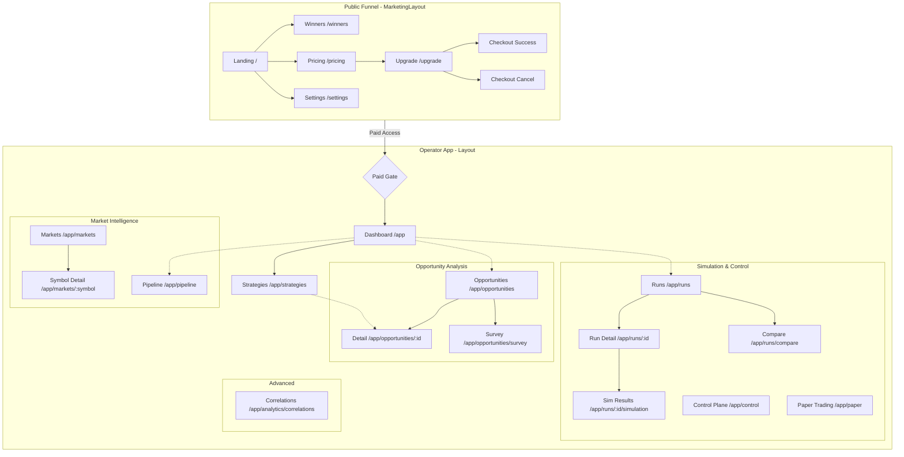

# MCAS Frontend Sitemap

This flowchart represents the current routing architecture and trust boundaries of the MCAS Frontend as defined in `App.jsx`.

### Zone Definitions

1.  **Public Funnel:** Marketing surfaces that consume static/curated JSON from `/public/curation/`.
2.  **The Gate:** A `PaidRoute` wrapper that checks local browser activation state.
3.  **Operator App:** The core interactive surface requiring a valid API base URL and session.
